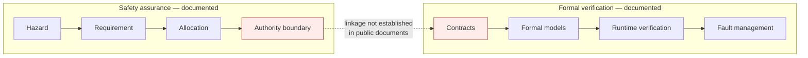
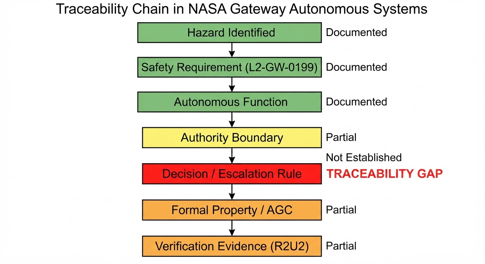
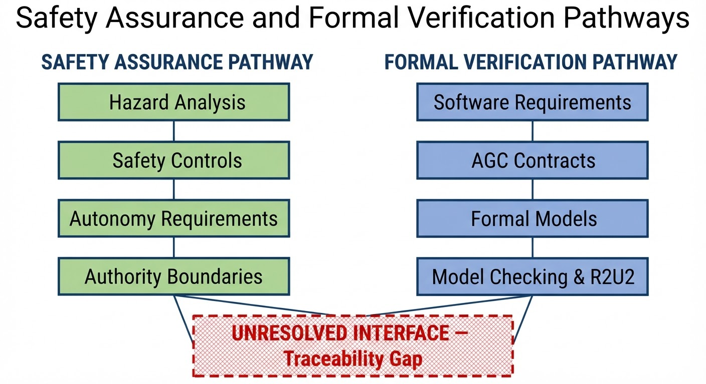
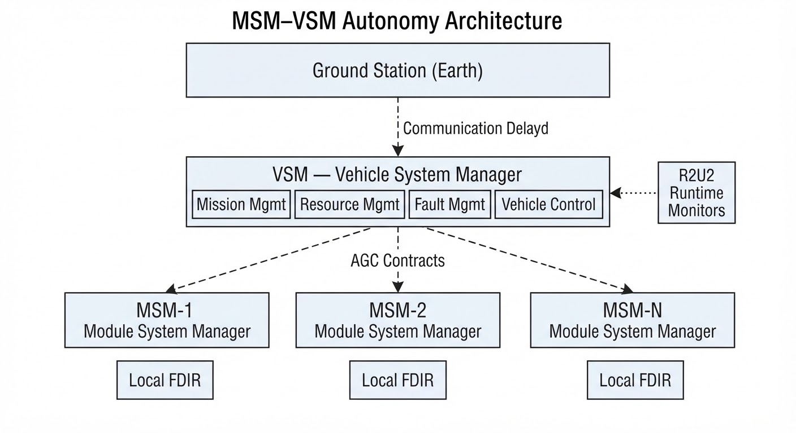
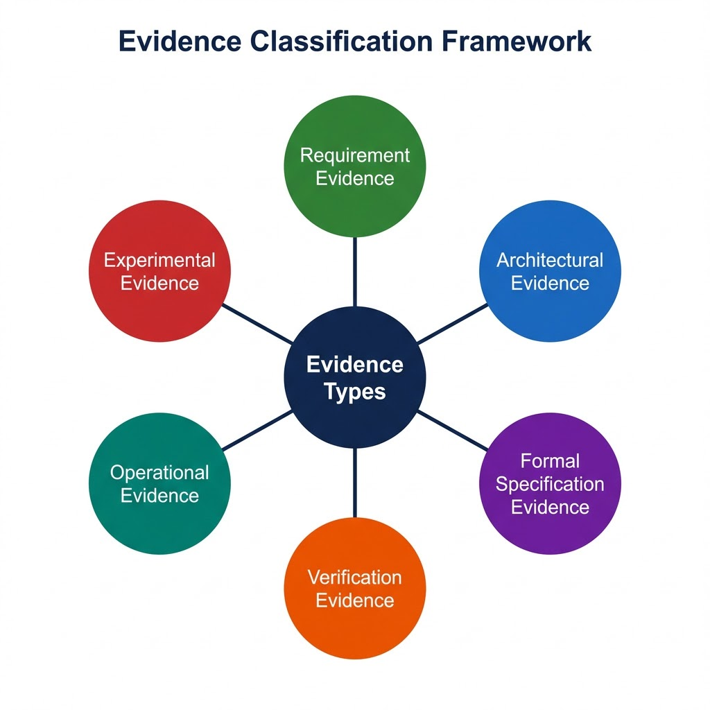
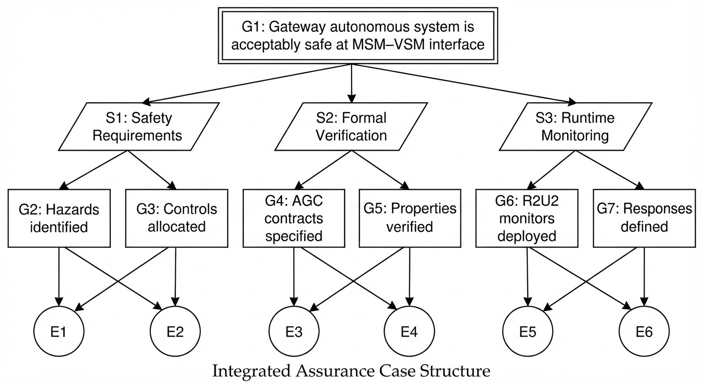

<div align="center">

# NASA Gateway — Safety Assurance & Formal Verification

### A Traceability Gap in Public Documentation

*A documentary analysis of safety-derived autonomy boundaries and formal verification mechanisms at the MSM–VSM interface in NASA Gateway autonomous systems.*

[](https://doi.org/10.5281/zenodo.24559255)
[](https://doi.org/10.6084/m9.figshare.35136991)
[](https://creativecommons.org/licenses/by/4.0/)
[](https://orcid.org/0009-0003-8903-0029)
[](CHANGELOG.md)
[](PHASE_II_CONSOLIDATED_REPORT.md)
[](tests/)
[-36%20pages-blue)](paper/NASA_Gateway_Traceability_Gap_Research_Paper_v1.0.0.pdf)
[](#figures)
[](#what-this-repository-does-not-claim)

[**Paper (PDF)**](paper/NASA_Gateway_Traceability_Gap_Research_Paper_v1.0.0.pdf) ·
[Paper (MD)](paper/NASA_Gateway_Safety_Assurance_and_Formal_Verification.md) ·
[Website](https://nasa-gateway.netlify.app) ·
[Zenodo](https://doi.org/10.5281/zenodo.24559255) ·
[Figshare](https://doi.org/10.6084/m9.figshare.35136991) ·
[GitHub](https://github.com/gitdeeper16/NASA-GATEWAY) ·
[Figures](figures/) ·
[Data](data/)

</div>

---

> [!IMPORTANT]
> **Scope of the finding.** It concerns **public documentation only**. It does **not** claim that any mechanism is absent from Gateway's implementation, and it never says NASA "lacks" a mechanism.

> [!NOTE]
> **Version 1.1.0** adds a Phase II Independent Evidence Review (II-bis, II-ter, II-quater, II-quinquies). The review produced 30 baseline records, 600 cycle-level records, and resolved three contradictions through code reading alone. No code was modified. **A.3 remains NOT OPENED.**

## Contents

[Overview](#overview) · [Central question](#central-question) · [Research questions](#research-questions) · [Scope](#scope) · [Method](#methodological-framework) · [Evidence classification](#evidence-classification) · [Phase II](#phase-ii--independent-evidence-review-v110) · [Findings](#findings) · [Figures](#figures) · [Repository structure](#repository-structure) · [Key sources](#key-sources) · [Non-claims](#what-this-repository-does-not-claim) · [Limitations](#research-limitations) · [Citation](#citation) · [Author](#author) · [License](#license)

---

## Overview

The study asks whether safety-derived boundaries of local autonomy can be traced, **using public documents alone**, to formally verifiable decision and escalation rules at the interface between Module System Managers (MSMs) and the Vehicle System Manager (VSM) in NASA Gateway.

Two engineering pathways are documented independently:

- **Safety-assurance pathway:** hazard analysis → safety requirements → autonomous functions → authority boundaries
- **Formal-verification pathway:** software requirements and scenarios → assume-guarantee contracts (AGCs) → formal models → runtime verification (R2U2) → fault management



[!NOTE]
The study does not propose a new architecture. It audits the traceability of publicly documented mechanisms.

Central question

How are safety-derived boundaries of local autonomy translated into formally verifiable decision and escalation rules at the interface between Module System Managers (MSMs) and the Vehicle System Manager (VSM) in NASA Gateway?

Component Focus Status in public documents
Safety-assurance pathway Hazard analysis, controls, autonomy requirements ✅ Documented
Formal-verification pathway AGC contracts, model checking, R2U2 ✅ Documented
Traceability chain Connection between the two pathways ⚠️ Not established

Research questions

ID Question Status
RQ1 How does Gateway distribute control responsibilities between MSM and VSM? ✅ Documented
RQ2 What safety requirements establish the need for autonomous hazard control? ✅ Documented (L2-GW-0199, as supplied)
RQ3 What formal and runtime verification mechanisms are documented? ✅ Documented (AGC, R2U2)
RQ4 Does public documentation establish a complete traceability chain? ⚠️ Not established

Scope

<table>
<tr><th>In scope</th><th>Out of scope</th></tr>
<tr><td>

· Documentary analysis of public NASA Gateway material
· Safety pathway: DSG-RQMT-001, GLS-RQMT-001, GLS-006
· Verification pathway: AGC, R2U2, development-time model checking
· The MSM–VSM interface
· Traceability from hazard to verification evidence

</td><td>

· Implementation claims
· Internal or controlled NASA artefacts
· Architectural redesign or recommendations
· Performance evaluation
· Verification of operational deployment

</td></tr>
</table>

Explicit non-goals: proving that NASA lacks any mechanism · proving that Gateway autonomy is unsafe · proving that the documentary gap reflects an implementation deficiency.

Methodological framework

An eight-step traceability sequence is applied. It is an analytical device, not a claim about a NASA process.

Step Element Reviewed public record
1 Hazard identified ✅ Located
2 Safety requirement derived ✅ Located (L2-GW-0199, as supplied)
3 Function allocated ⚠️ Partial (architecture level)
4 Authority boundary defined ⚠️ Partial (principles)
5 Decision / escalation rule specified ❌ Not established
6 Formal property or mechanism ⚠️ Mechanisms located; no trace to step 5
7 Verification evidence ⚠️ Published examples only
8 Operational response to violation ⚠️ Generic (R2U2 verdict → Fault Manager)

A link counts as established only if consecutive steps are tied together by the documents themselves (shared identifiers or explicit derivation), for a specific rule.

Evidence classification

Category What it can establish
Requirement What a system is required to do
Architectural Intended organisation and responsibilities
Formal specification Properties or contracts
Verification That a method was applied to a specified property
Operational Behaviour in an operational context
Experimental A concept demonstrated in a research setting

No category stands in for another.

Phase II — Independent Evidence Review (v1.1.0)

Version 1.1.0 adds a four-phase independent review of the experimental pipeline. The review was conducted under signed mandates and did not modify any project code.

Phase Scope Output Status
II-bis Baseline records (S1, S2, S5 × 5 seeds × 2 conditions) 30 summary rows ✅ Closed
II-ter Cycle-level records with real seed 600 JSONL rows, 780 log lines ✅ Closed
II-quater Code reading — three contradictions Resolved 1, 3; partial 2 ✅ Closed
II-quinquies Code reading — remaining contradiction Resolved 2 ✅ Closed

Three contradictions resolved:

1. escalation_requested_at is never populated in _trace_scenario.py (monitoring script defect, not engine).
2. safe=1 in S5 is correct; run_scenario produces it via rule R5/R5c. _trace_scenario.py does not reproduce it due to a different RuleView.
3. local_recovery_failures=0 while C2 remains unhealthy is consistent with _execute_local_action (contains only pass, no failure record).

Seed invariance: S1/S2/S5 are deterministic in fault injection. Seed variance is structurally impossible in these scenarios. Code modification: None. A.3: NOT OPENED. Pilot/Confirmatory: Not authorized.

Findings

Finding Status
Gateway distributes autonomy across MSM and VSM ✅ Documented
Local autonomy is tied to a formal safety obligation (L2-GW-0199) ✅ Documented (as supplied)
Distributed fault management is described ✅ Documented
AGC and R2U2 provide formal verification mechanisms ✅ Documented
Contracts and Fault Management are complementary ✅ Documented
Complete traceability chain, hazard to verification ❌ Not established in public documentation
Phase II experimental pipeline reviewed (v1.1.0) ✅ Complete

[!NOTE]
"Not established in public documentation" is not "absent from implementation." The paper keeps this distinction throughout.

Figures

<p align="center">
  <a href="figures/Fig1_Traceability_Chain_Gap.png"></a><br>
  <em>Figure 1 — Traceability chain gap (paper §6.3)</em>
</p>

<p align="center">
  <a href="figures/Fig2_Two_Pathways_Interface.png"></a><br>
  <em>Figure 2 — Two pathways interface (§6.1)</em>
</p>

<p align="center">
  <a href="figures/Fig3_MSM_VSM_Architecture.png"></a><br>
  <em>Figure 3 — MSM–VSM architecture (§5.1)</em>
</p>

<p align="center">
  <a href="figures/Fig4_Evidence_Classification_Taxonomy.png"></a><br>
  <em>Figure 4 — Evidence classification taxonomy (§4.4)</em>
</p>

<p align="center">
  <a href="figures/Fig5_Gateway_Lunar_Orbit.png"></a><br>
  <em>Figure 5 — Gateway in lunar orbit, contextual illustration (§2)</em>
</p>

<p align="center">
  <a href="figures/Fig6_Assurance_Case_GSN_Structure.png"></a><br>
  <em>Figure 6 — Assurance-case structure, GSN (§6.3)</em>
</p>

<details>
<summary><b>Figure index and numbering in the PDF</b></summary>

File Section Figure number in the PDF
Fig5_Gateway_Lunar_Orbit.png 2 1
Fig4_Evidence_Classification_Taxonomy.png 4.4 2
Fig3_MSM_VSM_Architecture.png 5.1 3
Fig2_Two_Pathways_Interface.png 6.1 4
Fig1_Traceability_Chain_Gap.png 6.3 5
Fig6_Assurance_Case_GSN_Structure.png 6.3 6

The PDF numbers figures by order of appearance and adds one organising figure (7). Figures 2–6 in the PDF are redrawn in a common style; Figure 5 (this repository) is a contextual illustration, not an engineering drawing.

</details>

Repository structure

```text
NASA-GATEWAY/
├── README.md · AUTHORS.md · CHANGELOG.md · CITATION.cff · CONTRIBUTING.md
├── INVENTORY.md · LICENSE · PROJECT_SUMMARY.txt · ROADMAP.md · VERSION
├── manifest.json · netlify.toml · scientific_state.json
├── PHASE_II_CONSOLIDATED_REPORT.md
│
├── paper/
│   ├── NASA_Gateway_Safety_Assurance_and_Formal_Verification.md
│   └── NASA_Gateway_Traceability_Gap_Research_Paper_v1.0.0.pdf
├── figures/        # Fig1 … Fig6 (PNG)
├── sources/        # Referenced NASA documents (links)
├── data/           # traceability_matrix.csv, evidence_classification.csv, requirement_to_property.csv
├── docs/           # methodology_notes.md, figure_provenance.md
├── scripts/        # validate.py, build_pdf.sh, build_latex.sh
├── phase2bis_experimental/
│   ├── phase2_all.log                    (30 summary rows)
│   ├── phase2ter_trace.jsonl             (600 JSONL rows)
│   ├── _trace_scenario.py
│   └── _trace_phase2.py
├── mandates/
│   ├── mandate_ii_quater.md
│   └── mandate_ii_quinquies.md
└── tests/          # 49 validation tests (run_all.sh + 5 suites)
```

Key sources

ID Source Role Verification status in the PDF¹
S1 NASA DSG-RQMT-001 (2019) Gateway system requirements C
S2 NASA GLS-RQMT-001 Logistics services requirements C
S3 NASA GLS-006 (2019) Safety data package C
P1 When the Eyes Don't Have It (2020) Locus of control / control authority B
P2 Using Assume-Guarantee Contracts for Operational Verification of Autonomous Spacecraft (2023) Formal-verification pathway C
P3 Gateway at the Crossroads of Sustainable Lunar Exploration (2023) Distributed fault management B
P4 Trustworthy Autonomy for Gateway Vehicle System Manager (2023) Domain of control C
P5 MAST (2019) Distributed hierarchical control A
P6 Gateway risk-reduction documentation (2022) MSM–VSM scenarios C
P7 Gateway to the Future: Lessons Learned in Development of the Refueling Systems (2024) Ground authorisation + autonomy B
P8 Implementation of a Stochastic Timeline Validation Tool Integrated With R2U2 (2026) R2U2 + timelines B

<sub>¹ A full text read · B public record located, details not re-read · C cited as supplied, text not located. Per-source detail and discrepancies are in the PDF, Appendices B and D.</sub>

What this repository does not claim

· ✖ That NASA lacks a traceability mechanism in implementation.
· ✖ That Gateway autonomy is unsafe or deficient.
· ✖ That the documentary gap implies implementation failure.
· ✖ Any causal claim beyond the documentary analysis.
· ✖ A complete inventory of internal NASA artefacts.

Research limitations

ID Limitation Note
L1 Access to detailed interface documents DSG-SPEC-VSM-003, MSM ICD, DSG-RQMT-011, DSG-RPT-001 not available in the public material reviewed
L2 Requirements vs. implementation Requirements establish obligations, not implementations
L3 Experimental evidence MAST and risk-reduction work are not operational Gateway
L4 Module-specific requirements GLS-RQMT-001 applies to the Logistics Module only
L5 Incomplete public verification coverage Published AGC examples are not exhaustive
L6 No independent review to date Author-only reasoning

Citation

Machine-readable metadata: CITATION.cff.

APA — Baladi, S. (2026). The Interface Between Safety Assurance and Formal Verification in NASA Gateway Autonomous Systems: A Traceability Gap in Public Documentation (Version 1.1.0). Zenodo. https://doi.org/10.5281/zenodo.24559255

<details>
<summary><b>BibTeX</b></summary>

```bibtex
@misc{baladi2026nasagateway,
  author    = {Baladi, Samir},
  title     = {The Interface Between Safety Assurance and Formal Verification in NASA Gateway Autonomous Systems: A Traceability Gap in Public Documentation},
  year      = {2026},
  version   = {1.1.0},
  publisher = {Zenodo},
  doi       = {10.5281/zenodo.24559255},
  url       = {https://doi.org/10.5281/zenodo.24559255},
  note      = {Phase II Independent Evidence Review}
}
```

</details>

Author

Samir Baladi — Principal Investigator, Author, and Protocol Designer
Ronin Institute / Rite of Renaissance

 
Email gitdeeper@gmail.com
ORCID 0009-0003-8903-0029
Website nasa-gateway.netlify.app
Zenodo 10.5281/zenodo.24559255
Figshare 10.6084/m9.figshare.35136991
GitHub gitdeeper16/NASA-GATEWAY
GitLab gitdeeper16/NASA-GATEWAY
Gitea gitdeeper16/NASA-GATEWAY
Codeberg gitdeeper16/NASA-GATEWAY
Bitbucket gitdeeper16/NASA-GATEWAY

License

Documentation and paper: CC BY 4.0.

---

<div align="center">

NASA Gateway — Safety Assurance & Formal Verification v1.1.0

© 2026 Samir Baladi · Ronin Institute / Rite of Renaissance

</div>
